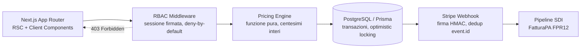

# Valkiria Fluidodinamica · Portale B2B & Listini Dinamici

**TechPYRE Reference Architecture #1** — progettata da [TechPYRE — Studio di Ingegneria del Software B2B](https://www.techpyre.eu) · Head of Studio: **Riccardo Granza**

[](https://nextjs.org)
[](https://www.typescriptlang.org/tsconfig#strict)
[](https://b2b-demo.techpyre.eu)
[](#licenza)

**Live Demo:** [https://b2b-demo.techpyre.eu](https://b2b-demo.techpyre.eu)

> [!IMPORTANT]
> **Azienda fittizia a scopo dimostrativo — dati simulati in memoria / nessun dato reale.**
> Valkiria Fluidodinamica S.r.l., i clienti (Officine Meccaniche Lario S.p.A., Idraulica Padana Distribuzione S.r.l.), le partite IVA, i listini, le fatture e gli eventi Stripe sono inventati. Nessun pagamento viene eseguito e nessun file viene trasmesso al Sistema di Interscambio. Nessun numero mostrato rappresenta il risultato di un cliente reale.

---

## Panoramica del caso d'uso

Valkiria Fluidodinamica S.r.l. è una PMI manifatturiera (sede fittizia in provincia di Bergamo, magazzini a Bergamo e Brescia) che produce valvole direzionali CETOP, elettrovalvole proporzionali, pompe a pistoni assiali, cilindri ISO 6020/2, raccorderia DIN 2353 e centraline oleodinamiche per l'industria pesante.

Il problema B2B tipico di una realtà di questo tipo:

- **listini non lineari**: ogni partita IVA ha un contratto (Offerta Base, Contratto Quadro Tier-1) con sconti in cascata e scaglioni di volume diversi;
- **ruoli con visibilità diverse**: il buyer tecnico vede il proprio netto, l'agente commerciale deve vedere costo industriale, margine e provvigione e poter negoziare entro limiti, l'amministrazione lavora su fatture elettroniche e riconciliazione pagamenti;
- **fiscalità italiana**: dichiarazioni d'intento (art. 8 c.1 lett. c) DPR 633/72), bollo virtuale, scadenze «60 gg DFFM», tracciato FatturaPA;
- **pagamenti asincroni**: eventi Stripe da ricevere in modo sicuro e idempotente.

La sandbox rende tutto esplorabile senza login: lo switcher nella barra TechPYRE cambia ruolo e cliente all'istante (stato in `?role=&company=` e `localStorage`, link condivisibile).

### Funzionalità della sandbox

| Area | Cosa dimostra |
| --- | --- |
| **RBAC & Tier Switcher** | `Permission` union a 15 valori, `ROLE_PERMISSIONS` deny-by-default, `can(role, permission)`. Colonne, prezzi e bottoni cambiano senza reload; le azioni negate mostrano «Permesso negato: ruolo X» con il badge del permesso richiesto. Pannello «Policy RBAC attiva» con matrice completa. |
| **Catalogo tecnico** | 14 componenti con pressione max, portata, temperatura, peso, giacenze BG/BS e lead time. Ricerca istantanea, filtri categoria e disponibilità. |
| **Pricing engine** | Listino → sconto contratto → scaglione volume (1–9, 10–49, 50+) → override agente validato su tetto e margine minimo. Centesimi interi, arrotondamento half-up a ogni passaggio. |
| **Checkout B2B** | Imponibile, risparmio vs listino, IVA 22% o non imponibilità N3.5 con protocollo, bollo virtuale, franco destino sopra soglia, bonifico 60 gg DFFM o Stripe (carta / SEPA DD B2B), split spedizione e backorder. |
| **Emissione ordine** | Pipeline animata: policy → `POST /api/v1/orders` (ricalcolo server) → allocazione giacenze → fattura e ID SdI → eventi `checkout.session.completed` e `invoice.created` → firma `Stripe-Signature` HMAC SHA-256 (Web Crypto) → consegna a `POST /api/webhooks/stripe` con verifica server → log. |
| **Amministrazione** | Registro fatture SDI, download reale dell'XML FatturaPA FPR12, log webhook con replay: lo stesso `event.id` ritrasmesso viene marcato `duplicate_ignored`. Il ruolo non può emettere ordini (403 lato server). |
| **Ispezione Architettura** | `schema.prisma` con highlighting scritto a mano, documentazione REST stile OpenAPI, pulsante «Esegui richiesta live» con status e tempo di risposta misurato. |

## Architettura



## Scelte ingegneristiche

### Perché zero CMS monolitici
Un portale B2B è un sistema transazionale, non un sito di contenuti. Listini, scaglioni, permessi e fiscalità sono **logica di dominio tipizzata e testabile** (`src/lib/*`), non configurazioni sparse in plugin. Il risultato è un bundle leggero (solo `next`, `react`, `tailwindcss`, `lucide-react`), una pagina prerenderizzata staticamente e nessuna superficie d'attacco legata a pannelli amministrativi generici.

### Prezzi calcolati lato server, in centesimi interi
- Ogni importo è un intero in centesimi, ogni percentuale in basis point (`100 bp = 1%`): nessun errore di virgola mobile.
- Lo sconto è applicato in cascata con arrotondamento half-up al centesimo a ogni passaggio; il totale di riga è `prezzo unitario × quantità`, coerente con il `PrezzoTotale` del tracciato FatturaPA.
- Il client mostra un'anteprima, ma **il server ricalcola tutto**: `POST /api/v1/orders` ignora qualsiasi prezzo inviato e la pipeline interrompe l'emissione se i totali divergono.

### Concorrenza sugli ordini
In produzione l'emissione avviene in una singola transazione Prisma:
1. `INSERT` dell'ordine con `idempotencyKey` univoca (un retry del client non duplica l'ordine);
2. decremento giacenza con **optimistic locking** (`UPDATE … WHERE sku = $1 AND version = $2`, campo `version` nello schema) oppure `SELECT … FOR UPDATE` sulle righe prodotto nei casi ad alta contesa;
3. allocazione BG → BS → backorder identica a quella mostrata nella sandbox.

### Webhook Stripe: firma e idempotenza
- La firma è verificata **sul body grezzo prima del parsing**: HMAC SHA-256 su `timestamp.payload`, tolleranza di 300 secondi contro i replay attack, confronto a tempo costante.
- Deduplica su `event.id`: la tabella `ProcessedStripeEvent` ha l'id come chiave primaria e viene scritta nella stessa transazione dell'effetto di dominio. Un duplicato riceve comunque `200` (altrimenti Stripe ritenta) ed è registrato come `DUPLICATE_IGNORED` in `WebhookLog`.

### Sicurezza RBAC
- **Deny-by-default**: un permesso non elencato in `ROLE_PERMISSIONS` è negato.
- **Mai fidarsi del client**: la UI usa la matrice solo per l'esperienza utente; i Route Handler rivalutano gli stessi permessi, filtrano i campi sensibili (`industrialCostCents`, margini, provvigioni) e rispondono `403` alle azioni non autorizzate.
- I ruoli cliente sono vincolati alla propria P.IVA; solo Agente e Amministrazione possono operare per conto di più clienti.

## Sandbox vs produzione

| Aspetto | Sandbox pubblica | Produzione |
| --- | --- | --- |
| Autenticazione | Nessuna: ruolo scelto dallo switcher, passato come parametro | Sessione firmata in cookie `httpOnly` (es. Auth.js / OIDC aziendale), ruolo derivato dal server |
| Dati | Catalogo, giacenze, fatture e log in memoria nel browser; reset al ricaricamento | PostgreSQL con lo schema in `prisma/schema.prisma`, migrazioni versionate |
| Ordini | Route Handler reale che autorizza e ricalcola, senza persistenza | Transazione con idempotency key e locking sulle giacenze |
| Stripe | Eventi costruiti nel browser con struttura fedele all'API, firmati con un segreto dimostrativo pubblico | Eventi reali da Stripe, segreto in `STRIPE_WEBHOOK_SECRET`, dedup persistente |
| SDI | XML FPR12 generato e scaricabile, esito «RC» simulato | Firma/invio tramite intermediario accreditato, gestione notifiche RC/NS/MC |
| Giacenze nei Route Handler | Valori iniziali di riferimento | Lettura transazionale dal database |

## Struttura delle cartelle

```text
├── prisma/schema.prisma            # schema PostgreSQL target (documentazione, Prisma non installato)
├── scripts/sync-prisma-schema.mjs  # sincronizza lo schema nella costante TS (--check in prebuild)
└── src/
    ├── app/
    │   ├── api/v1/catalog/route.ts         # GET catalogo con filtro campi per ruolo
    │   ├── api/v1/pricing/quote/route.ts   # GET quotazione a scaglioni
    │   ├── api/v1/orders/route.ts          # POST ordine: RBAC + ricalcolo server-side
    │   ├── api/webhooks/stripe/route.ts    # POST webhook con verifica firma HMAC
    │   ├── layout.tsx · page.tsx · globals.css · icon.svg
    ├── components/                 # Client Components mirati (top bar, catalogo, carrello, admin…)
    ├── data/                       # catalogo, anagrafiche, documentazione API, schema generato
    ├── hooks/useDemoSession.ts     # ruolo/cliente sincronizzati con URL e localStorage
    ├── lib/                        # logica pura: rbac, pricing, checkout, orders, stripe, fatturapa, webhooks
    └── types/index.ts              # tipi di dominio strict (Role, Permission, PriceQuote, eventi Stripe…)
```

## Avvio locale

Requisiti: Node.js ≥ 20.9, npm.

```bash
npm install
npm run dev            # http://localhost:3000
npm run typecheck      # tsc --noEmit
npm run lint           # eslint
npm run build          # include il controllo di allineamento dello schema Prisma
npm run sync:schema    # dopo ogni modifica a prisma/schema.prisma
```

Esempi di chiamate:

```bash
curl "http://localhost:3000/api/v1/pricing/quote?sku=VLK-CT03-24V&qty=12&role=buyer"
curl "http://localhost:3000/api/v1/catalog?q=CETOP&role=agent"
curl -X POST http://localhost:3000/api/v1/orders \
  -H "Content-Type: application/json" -H "Idempotency-Key: $(uuidgen)" \
  -d '{"role":"admin","companyId":"padana","vatRegime":"ordinaria","paymentMethod":"bonifico_60_dffm","lines":[{"sku":"VLK-VMP-350","quantity":60,"overrideDiscountBp":0}]}'
# → 403 forbidden, requiredPermission: order:submit
```

## Deploy su Vercel

Il progetto non richiede variabili d'ambiente.

```bash
npx vercel link --project techpyre-b2b-portal-reference
npx vercel --prod
```

La home è prerenderizzata staticamente; i quattro Route Handler sono funzioni serverless.

## Licenza

MIT © TechPYRE — Riccardo Granza. Vedi [LICENSE](./LICENSE).

---

Reference Architecture progettata da **TechPYRE** — Studio di Ingegneria del Software B2B · [https://www.techpyre.eu](https://www.techpyre.eu) · Head of Studio: Riccardo Granza
